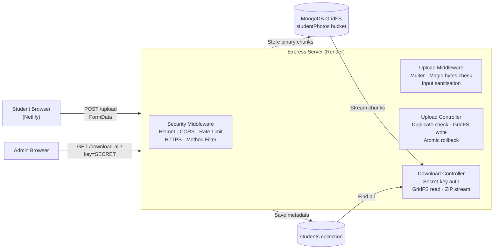

# Student Passport Photo Collection Portal

A focused, production-grade web portal built for **Nellai College of Engineering — Department of Computer Science and Engineering (Final Year)** to collect and manage student passport-size photographs digitally. Students submit their photo once through a clean web form; administrators can bulk-download all photos as a single ZIP archive via a secret-key-protected endpoint.

---

## Overview

| Property | Detail |
|---|---|
| **Purpose** | Replace manual/email-based photo collection with a single-page self-service portal |
| **Target Users** | Final-year CSE students (submitters) and the class coordinator (admin) |
| **Storage** | Photos stored in **MongoDB GridFS** — no filesystem dependency in production |
| **Backend** | Node.js / Express REST API |
| **Frontend** | Vanilla HTML + CSS + JS (served as static files by Express) |
| **Deployment** | Backend → [Render](https://render.com) · Frontend → [Netlify](https://netlify.com) |

---

## Features

### Student-Facing

- **Glassmorphism single-page upload form** — Student Name, Register Number, and a photo upload field
- **Drag-and-drop + click-to-browse** file selection with live image preview
- **Client-side validation** — file type (JPG/JPEG/PNG), file size (≤ 40 KB), required fields, register-number format (alphanumeric, 8–15 chars, auto-uppercase)
- **Animated success screen** shown for 4 seconds after upload, then auto-resets for the next student
- **Duplicate prevention** — one upload per register number; subsequent attempts are rejected with a clear error message

### Admin-Facing

- **Bulk ZIP download** — all uploaded photos streamed directly from GridFS into a ZIP archive (`FinalYear_CSE_Passport_Photos.zip`)
- **Secret-key protected download endpoint** — requires a `?key=` query parameter matching `DOWNLOAD_SECRET`

### Backend / Security

- **Magic-bytes verification** — uploaded file buffer checked against PNG (`89504E47`) and JPEG (`FFD8FF`) binary signatures before accepting
- **Double-extension rejection** — filenames with more than one dot are refused
- **Input sanitisation** — student name and register number stripped of path-traversal sequences, control characters, and injection payloads
- **Rate limiting** — 5 uploads per IP per 15 minutes via `express-rate-limit`
- **Helmet security headers** — CSP, `X-Frame-Options: DENY`, Referrer-Policy
- **HTTPS enforcement** — HTTP requests blocked in `NODE_ENV=production`
- **Strict CORS** — production origin whitelist (`https://stdpassportpic.netlify.app`); localhost permitted in development
- **HTTP method filter** — only `GET`, `POST`, `OPTIONS` accepted; all others return `405`
- **Cache prevention headers** — `no-store, no-cache` on all responses
- **Directory listing blocked** — `/uploads` path returns `403 Forbidden`
- **Atomic GridFS rollback** — if the MongoDB Student document fails to save after the binary is uploaded, the orphaned GridFS file is deleted automatically
- **Global error handler** — prevents stack-trace leakage in all error responses

---

## Tech Stack

| Layer | Technology |
|---|---|
| Runtime | Node.js |
| Framework | Express 4 |
| Database | MongoDB (Mongoose 8) |
| File storage | MongoDB GridFS (`studentPhotos` bucket) |
| File upload | Multer (memory storage) |
| ZIP generation | Archiver |
| Security | Helmet · express-rate-limit |
| Compression | compression (GZIP) |
| Config | dotenv |
| Frontend | HTML5 · Vanilla CSS · Vanilla JS |
| UI Library | Bootstrap 5.3 · Bootstrap Icons 1.11 |
| Fonts | Google Fonts — Inter, Outfit |

---

## Architecture



---

## Project Structure

```
passport-size-photo/
├── backend/
│   ├── controllers/
│   │   ├── downloadController.js   # Bulk ZIP download (GridFS → archiver → response)
│   │   └── uploadController.js     # Upload handler (validate → GridFS → MongoDB)
│   ├── middleware/
│   │   ├── securityMiddleware.js   # Rate limit, HTTPS, CORS, method filter, cache headers
│   │   └── uploadMiddleware.js     # Multer config, file-type & size validation
│   ├── models/
│   │   └── Student.js              # Mongoose schema
│   └── routes/
│       └── uploadRoutes.js         # POST /upload · GET /download-all
├── frontend/
│   ├── index.html                  # Single-page upload form (Bootstrap 5)
│   ├── script.js                   # Client-side validation, drag-drop, fetch API call
│   └── style.css                   # Glassmorphism dark-mode design system
├── uploads/                        # Local fallback dir (gitignored; not used in production)
├── migration.js                    # One-time utility: local files → GridFS migration
├── server.js                       # Express entry point, MongoDB connection, middleware chain
├── package.json
├── .env.example
└── .gitignore
```

---

## Installation

### Prerequisites

- Node.js ≥ 18
- A running MongoDB instance (local or MongoDB Atlas)

### Steps

```bash
# 1. Clone the repository
git clone https://github.com/thronmuthu18/student-passport-photo-portal.git
cd student-passport-photo-portal

# 2. Install dependencies
npm install

# 3. Configure environment variables
cp .env.example .env
# Open .env and fill in your values (see Environment Variables section)

# 4. Start the server
npm start
```

The server starts on `http://localhost:5000` by default. Open that URL in a browser to access the upload portal.

---

## Environment Variables

Copy `.env.example` to `.env` and fill in your values:

```env
# Server port (default: 5000)
PORT=5000

# MongoDB connection string
MONGODB_URI=mongodb://127.0.0.1:27017/student_passport_portal

# Secret key required to access the /download-all endpoint
# Use a strong, random value in production
DOWNLOAD_SECRET=your_strong_secret_here
```

> **Never commit your `.env` file.** It is listed in `.gitignore`.

---

## API Reference

| Method | Endpoint | Auth | Description |
|---|---|---|---|
| `POST` | `/upload` | None | Upload a single student passport photo |
| `GET` | `/download-all` | `?key=DOWNLOAD_SECRET` | Stream all photos as a ZIP archive |

### `POST /upload`

**Content-Type:** `multipart/form-data`

| Field | Type | Constraints |
|---|---|---|
| `studentName` | string | 2–50 characters |
| `registerNumber` | string | Alphanumeric, 8–15 chars, auto-uppercased |
| `photo` | file | JPG / JPEG / PNG only · max **40 KB** |

**Success `200`:**
```json
{
  "success": true,
  "message": "Upload Successful",
  "student": {
    "studentName": "JOHN-DOE",
    "registerNumber": "7376222CS001"
  }
}
```

**Error `400 / 429 / 500`:**
```json
{
  "success": false,
  "message": "This Register Number has already uploaded a photo."
}
```

### `GET /download-all?key=<DOWNLOAD_SECRET>`

Streams `FinalYear_CSE_Passport_Photos.zip` containing all photos read from GridFS.

| Status | Meaning |
|---|---|
| `200` | ZIP stream returned (or plain-text message if no photos exist) |
| `401` | Key parameter missing |
| `403` | Key incorrect |
| `500` | Server configuration error |

---

## Database

**Technology:** MongoDB via Mongoose

### `students` collection

| Field | Type | Notes |
|---|---|---|
| `studentName` | String | Required, trimmed, sanitised |
| `registerNumber` | String | Required, unique, uppercase |
| `photoFileName` | String | Format: `<REG>-<NAME>.<ext>` |
| `photoPath` | String | Legacy compatibility field |
| `photoFileId` | ObjectId | Reference to `studentPhotos.files` in GridFS |
| `uploadedAt` | Date | Defaults to `Date.now` |

### GridFS — `studentPhotos` bucket

Binary photo data is stored in `studentPhotos.files` (metadata) and `studentPhotos.chunks` (binary chunks). Each GridFS file carries `studentName`, `registerNumber`, `originalName`, and `uploadedAt` as embedded metadata.

---

## Security

All mechanisms below are verified from source code — none are aspirational.

| Mechanism | File |
|---|---|
| Magic-bytes (PNG/JPEG) verification | `uploadController.js` |
| Double-extension filename rejection | `uploadMiddleware.js` |
| Input sanitisation (path traversal, control chars) | `uploadController.js` |
| Duplicate register number prevention | `uploadController.js` |
| Atomic GridFS rollback on save failure | `uploadController.js` |
| Rate limiting (5 req / IP / 15 min) | `securityMiddleware.js` |
| HTTPS enforcement (production) | `securityMiddleware.js` |
| Strict origin CORS whitelist | `securityMiddleware.js` |
| HTTP method filter (GET, POST, OPTIONS) | `securityMiddleware.js` |
| Cache-control `no-store` headers | `securityMiddleware.js` |
| Helmet (CSP, X-Frame-Options, Referrer-Policy) | `server.js` |
| `X-Powered-By` header disabled | `server.js` |
| `/uploads` directory listing blocked | `server.js` |
| Stack-trace suppression in error responses | `server.js` |
| Download secret key (`DOWNLOAD_SECRET`) | `downloadController.js` |

---

## Data Migration Utility

`migration.js` is a one-time script to migrate photos that were originally saved as local files (before GridFS was adopted) into MongoDB GridFS.

```bash
node migration.js
```

It reads Student records that lack a `photoFileId`, locates the corresponding file under `uploads/`, streams it to GridFS, and updates the database record. Records already pointing to GridFS are skipped safely. A summary report is printed at the end.

---

## Known Limitations

- No admin dashboard — the download endpoint is the only administrative interface.
- No authentication for student submissions — any visitor with the URL can attempt an upload (rate limiting and duplicate detection are the primary guardrails).
- `DOWNLOAD_SECRET` is transmitted as a plain URL query parameter; always use HTTPS in production to prevent interception.
- The 40 KB file size cap may be restrictive for higher-resolution passport photos from modern smartphones.

---

## Future Improvements

- Admin dashboard to view, search, and delete individual student records
- Email confirmation sent to students on successful upload
- Per-department or per-batch photo collection with separate download sets
- Student authentication via college-issued email OTP

---

## Contributing

This is an internal institutional tool. To suggest improvements, open an issue or pull request on the repository.

---

## License

**ISC** — as declared in `package.json`.

---

## Author

**Nellai College of Engineering — Department of Computer Science and Engineering**  
Built for the Final Year Batch Passport Photo Collection drive.

> For deployment or support questions, contact the class coordinator or the system maintainer.
